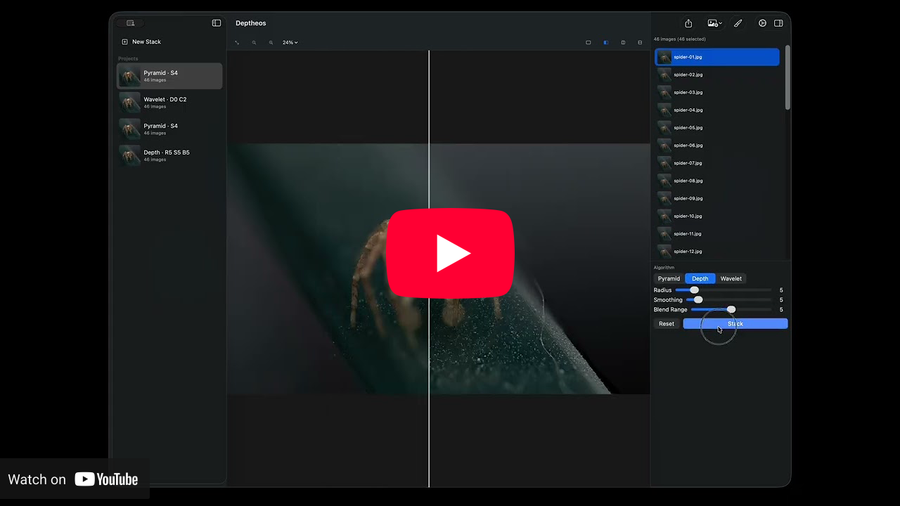

# Deptheos

>Deptheos is a fast, Metal accelerated focus stacking application for MacOS. It features three focus stacking algorithms to try on your image stacks. Supports RAW file input, with DNG output.

## Features

### Speed

Lightning fast stacking even with large images, with most operations written as Metal compute shaders.

With disk IO and full algorithm.

#### JPEG MacBook Pro M5 Max (40c)

* Pyramid 200 image 8192 × 5464 JPEG images: 1198.37 Mpx/s (7.470s)
* Depth 200 image 8192 × 5464 JPEG images: 1003.38 Mpx/s (8.922s)
* Wavelet 200 image 8192 × 5464 JPEG images: 782.78 Mpx/s (11.436s)

#### RAW (CR3) MacBook Pro M5 Max (40c)

* Pyramid 200 image 8192 × 5464 CR3 RAW images: 347.54 Mpx/s (25.967s)
* Depth 200 image 8192 × 5464 CR3 RAW images: 174.45 Mpx/s (51.731s)
* Wavelet 200 image 8192 × 5464 CR3 RAW images: 172.95 Mpx/s (52.179s)

### Three Stacking Methods

#### Pyramid

Fastest and likely the best for general use. Only has one pass over images, so good for long stacks. Does not preserve colors as accurately as other methods due to it reconsutructing images from the image pyramid.

Wang, Wencheng & Chang, Faliang. (2011). A Multi-focus Image Fusion Method Based on Laplacian Pyramid. JCP. 6. 2559-2566. 10.4304/jcp.6.12.2559-2566.

#### Depth

Comes up with the best image index at each pixel using the focus metric. Smooths the depth map using a cascaded IIR recursive filter (domain-transform recursive filter) guided by the opacity/confidence map, preserving edges where focus transitions are sharp. Passes over the images a second time to blend them according to the depth map with configurable blend range.

The below paper is modified to use confidence dampening from the focus metrics instead of it being self-guided.

Eduardo S. L. Gastal and Manuel M. Oliveira. 2011. Domain transform for edge-aware image and video processing. ACM Transactions on Graphics 30, 4, Article 69.

#### Wavelet

Forster, B., Van De Ville, D., Berent, J., Sage, D., & Unser, M. (2004). Complex wavelets for extended depth-of-field: A new method for the fusion of multichannel microscopy images. Microscopy Research and Technique, 65(1–2), 33–42.

https://github.com/PetteriAimonen/focus-stack

### Alignment and Cropping

Images are aligned against each other in a chain when stacking correcting for translation, scale, shear and rotation. The final output image is cropped to the intersecting area.

The alignment is the same as the OpenCV ECC [algorithm](https://github.com/opencv/opencv/blob/4.x/modules/video/src/ecc.cpp).

Evangelidis, Georgios & Psarakis, Emmanouil. (2009). An ECC Based Iterative Algorithm For Photometric Invariant Projective Registration. International Journal on Artificial Intelligence Tools. 18. 121-139. 10.1142/S021821300900007X. 

Szeliski, R. (2006). Image Alignment and Stitching: A Tutorial. Foundations and Trends in Computer Graphics and Vision, 2(1), 1–104. https://doi.org/10.1561/0600000009 (https://pages.cs.wisc.edu/~dyer/cs534/papers/szeliski-alignment-tutorial.pdf)

### RAW input, DNG output

Allows three methods of handling RAW images.

* LibRaw - Will use LibRaw to debayer the raw images, if it finds Adobe DCP profiles for the camera, will default to use that profile to interpret the colors over the default LibRaw profile.
* Adobe DNG - You must have [Adobe DNG Converter](https://helpx.adobe.com/ca/camera-raw/using/adobe-dng-converter.html) installed. Will use a background process to convert your RAW images into temporary linear DNG files for processing.
* Apple - Will use Apple's default RAW handling

LibRAW and Adobe DNG methods allow exporting the final image as a linear DNG file for further processing in an editor.

### Lanczos Warping

Uses higher quality Lanczos image warping for the core alignment of the input images.

### Painting

Can retouch images after stacking to make corrections.

## Example Images

These images are stacked with Deptheos.

Source images: [JPEG (250MB)](https://images.deptheos.com/spider1-jpeg.zip) | [RAW/CR3 (711MB)](https://images.deptheos.com/spider1-cr3.zip), 46 images

### Future

Future project ideas I'm considering.

* iPad App - The current version will run on an iPad Pro M5, since it has enough RAM, but I haven't tested enough or know how to target just M series iPad Pros
* WGPU version - I had a prototype version where the core stacking algorithms are implemented in Rust with WGPU, and a C FFI layer for the Swift application. I justed decided to keep the initial version simpler with Metal and Swift. The WGPU version would allow the core algorithms to work on Windows, Mac and Linux

### Other Notes

* Your project files created in the application are stored in '~/Library/Application Support/Deptheos/Projects'. They are .deptheos format, but you can open them in Finder to see the project settings and images.
* Still needs documenting, but you can run a CLI version of stacking algorithms as DeptheosKit has a DeptheosCLI product for a CLI.
