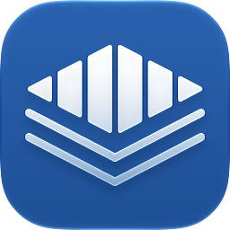
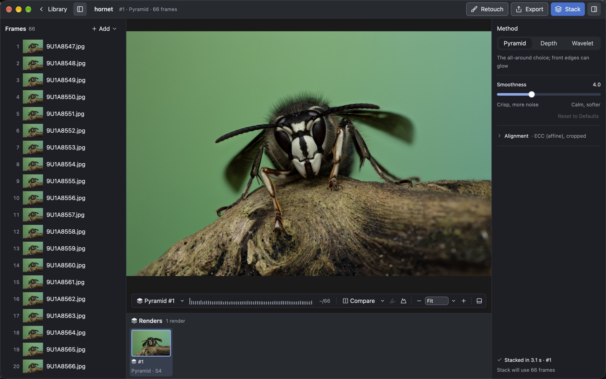

# Deptheos

<p align="center">

</p>

<p align="center"><b>Focus stacking in seconds.</b><br>
Free and open-source focus stacking for macro, product and landscape photography, on the GPU. Stack camera RAW straight to 16-bit linear DNG, choose from three methods, and retouch from any source frame.</p>

<p align="center">
<a href="https://github.com/ryanmitts/deptheos/releases/latest"></a>
<a href="LICENSE.md"></a>

</p>

<p align="center">
<b><a href="https://github.com/ryanmitts/deptheos/releases/latest">Download</a></b> · <a href="https://deptheos.com">deptheos.com</a> · <a href="https://deptheos.com/docs/">Docs</a> · <a href="https://deptheos.com/gallery/">Gallery</a>
</p>


| 2.0 s | 5.2 s | RAW in, DNG out | Free |
|:-:|:-:|:-:|:-:|
| 66 JPEG frames, 45 MP, handheld | 200 JPEG frames, 45 MP, on a tripod | 16-bit linear, floating-point throughout | GPL-3.0, no tiers or account |

Times are whole stacks on an Apple M5 Max, read off disk, aligned and blended; the same 200 frames as CR3 take 34 s, with no separate conversion. An RTX 5090 does the 200 JPEG frames in 4.9 s. Frames stream through memory a few at a time, so a 300-frame stack needs no more memory than a 30-frame one. [Every timing](https://deptheos.com/#speed).

## From a folder of frames to a finished stack

Drop a folder of focus-bracketed frames onto the window, pick a method and press Stack. Inspect the result at 100%, retouch problem edges from any source frame, and export.



- **Three methods.** Pyramid, the default, keeps crossing hairs, bristles and antennae crisp. Depth keeps smooth gradients, plain backgrounds and true color. Wavelet takes each pixel's color whole from one frame, for fine repeating texture. Stack with two and paint one onto the other. [Choosing a method](https://deptheos.com/docs/methods/)
- **Automatic alignment** for handheld and rail stacks: the ECC aligner for shift, rotation, scale and slant, or Grid search, with exposure compensation. A frame that can't be aligned is left out, not forced in. [Alignment](https://deptheos.com/docs/alignment/)
- **RAW and DNG in, 16-bit linear DNG out**, still editable in your RAW editor; or TIFF, PNG and JPEG. [RAW, DNG and color](https://deptheos.com/docs/raw/)
- **Split view** to compare two renders, or a render and a source frame, under a line you drag, with Side by Side and Flicker too; **Depth Map** and **Contribution** show where each part of the result came from.
- **Retouching** from any frame or another render, non-destructive; ⌥-click paints from the frame sharpest there.
- **A Library** that keeps every render, its settings and its frames.
- **Batch**: a card's worth of stacks in one run, one stack per folder or split by capture time; and **sequences** of numbered stacks for turntable and grow animations.
- **A command line**, `deptheos`, for the same from a terminal.

[Every feature](https://deptheos.com/features/) and a [getting started guide](https://deptheos.com/docs/getting-started/) are on the website.

## Download

Installers are on the [Releases](https://github.com/ryanmitts/deptheos/releases/latest) page; [Installing](https://deptheos.com/docs/install/) has the steps for each system.

| Platform | Needs | Files |
|---|---|---|
| macOS | macOS 27 or later, Apple silicon (no Intel build) | a signed and notarized `.dmg` |
| Windows | Windows 10 or later, 64-bit | an installer (not code-signed yet, so SmartScreen warns), or a portable `.zip` |
| Linux (preview) | x86-64 or ARM64, glibc 2.35 or newer (Ubuntu 22.04, Debian 12, Fedora 36 and later), a Vulkan driver | `.deb`, `.rpm` or a tarball |
| iPhone and iPad | iPhone 15 Pro or newer, or an iPad with an M-series or A17 Pro chip; iOS or iPadOS 26 | the [public beta on TestFlight](https://testflight.apple.com/join/XheabQmv); the App Store after it |

Stacking runs on the GPU (Metal, DirectX 12 or Vulkan; integrated graphics will do), and 16 GB of memory is recommended. A Windows or Linux computer with no GPU stacks on the CPU instead, much more slowly.

Your frames and renders stay on your computer, and there is no account. The desktop app makes one request over the network, the update check: at startup it asks GitHub for the latest release, sending only the app's version. Turn it off under Settings ▸ General ▸ Check for updates. The command line and the iPhone and iPad app make none. Nothing else is collected and nothing tracks you: the [privacy policy](https://deptheos.com/privacy/) says exactly what is sent, and [Support](https://deptheos.com/support/) how to send diagnostics when you choose to.

## Sample stacks

Spider, 46 frames: [JPEG (250 MB)](https://images.deptheos.com/spider1-jpeg.zip) · [CR3 (711 MB)](https://images.deptheos.com/spider1-cr3.zip)

Hornet, 66 frames, handheld: [JPEG (264 MB)](https://images.deptheos.com/samples/hornet-jpeg.zip) · [CR3 (1.1 GB)](https://images.deptheos.com/samples/hornet-cr3.zip)

Circuit board, 200 frames, on a tripod: [JPEG (412 MB)](https://images.deptheos.com/samples/pcb-jpeg.zip) · [CR3 (3.1 GB)](https://images.deptheos.com/samples/pcb-cr3.zip)

## Command line

`deptheos` comes with the app and stacks from a terminal:

```sh
deptheos pyramid -o out.dng frames/*.CR3
deptheos depth -o out.tif frames/*.jpg
deptheos align -o aligned/ frames/*.CR3   # the frames aligned, for another editor
deptheos batch pyramid --split auto -o renders/ card/
deptheos bench frames/   # time whole stacks on your machine
```

`deptheos --help` lists the commands; [the command line](https://deptheos.com/docs/cli/) has where it is installed on each system and the options. From the source, `cargo run --release -p deptheos_cli -- <command> …` does the same.

## Building

The workspace is Rust with a few C++ libraries: LibRaw (a submodule) and the Adobe DNG SDK (vendored). `just check` needs [Rust](https://rustup.rs) 1.93 or newer (`rust-version` in `Cargo.toml`), [just](https://just.systems) and [Node](https://nodejs.org) 22 for the website's tests.

```sh
git submodule update --init
(cd web && npm install)                # the website's packages, which `just check` tests
cargo run --release -p deptheos_gpui   # the desktop app
just check                             # the fast tests; `just` lists every recipe
```

How the crates fit together and where a stack runs: [docs/architecture.md](docs/architecture.md).

- macOS: Xcode 27 or newer, whose SDK the macOS 27 floor needs (ADR-102); the full Xcode, not only the command line tools.
- Windows: Visual Studio's C++ tools; see [docs/windows.md](docs/windows.md).
- Linux: a C++ toolchain, `pkg-config` and the development headers GPUI links against. On Ubuntu or Debian:

  ```sh
  sudo apt install build-essential pkg-config cmake clang \
    libfontconfig-dev libfreetype-dev libxkbcommon-dev libxkbcommon-x11-dev \
    libwayland-dev libx11-xcb-dev libxcb1-dev libvulkan-dev libasound2-dev \
    libssl-dev libzstd-dev
  ```

  These are only for building. To run the app, you also need a Vulkan driver (`mesa-vulkan-drivers`, or your GPU vendor's). In a VM, turn on the virtual GPU's acceleration (in UTM, virtio-gpu with GPU acceleration on), or the app falls back to Mesa's CPU renderer.
- iOS: the app links the Rust engine as an XCFramework, which Xcode does not rebuild. Add the Rust targets once (`rustup target add aarch64-apple-ios aarch64-apple-ios-sim`). Run `just ios-engine` (a debug build of the XCFramework; `ios/build-xcframework.sh` alone makes a release one) first and again after every Rust change, then open `ios/DeptheosMobile.xcodeproj`, or `just ios-build` to build it by scheme from the command line.

  The app opens in the Simulator but can't stack there: the Simulator's GPU lacks a feature the engine needs. Stack on a device. To sign it for a device, set your own Apple team in place of `T5PCWU6J56` in `ios/DeptheosMobile.xcodeproj` and `ios/ExportOptions.plist`.
- Release builds and installers: [docs/releasing.md](docs/releasing.md).
- The website: `cd web && npm install && npm run dev`; the rest, including deploying and retaking the benchmarks, is in [web/README.md](web/README.md).

## Credits

The wavelet method is adapted from Petteri Aimonen's [focus-stack](https://github.com/PetteriAimonen/focus-stack) (MIT), and the ECC aligner is derived from OpenCV's [`findTransformECC`](https://github.com/opencv/opencv/blob/4.x/modules/video/src/ecc.cpp); their notices are in [THIRD_PARTY_NOTICES.txt](THIRD_PARTY_NOTICES.txt). How each method works, step by step, and the papers each follows are in [docs/algorithms](docs/algorithms/README.md).

## License

GPL-3.0, with additional permissions to combine Deptheos with the Adobe DNG SDK, the XMP Toolkit and LibRaw and to distribute it through app stores ([LICENSE.md](LICENSE.md)). Contributions are welcome, under the same terms ([CONTRIBUTING.md](CONTRIBUTING.md)). The name and logo are not covered by the license: forks are welcome under their own name ([TRADEMARKS.md](TRADEMARKS.md)). The photographs (the sample stacks, the website's pictures and the test images) are all rights reserved and not under the GPL ([LICENSE.md](LICENSE.md)).

Built with [wgpu](https://wgpu.rs), [LibRaw](https://www.libraw.org) and the [Adobe DNG SDK](https://helpx.adobe.com/camera-raw/digital-negative.html). Every bundled library and its license is listed in [THIRD_PARTY_NOTICES.txt](THIRD_PARTY_NOTICES.txt); regenerate it with `just notices` after changing a dependency.
