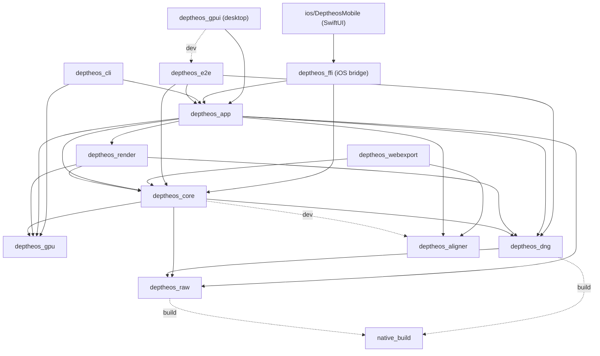

# Architecture

How the code is put together, so a change lands in the right crate and on
the right thread. Why each part is built as it is lives in the decision
records it cites (`docs/decisions/`).

## The crates

The front ends depend on `deptheos_app` and nothing below it but what they
must: the desktop on `deptheos_app` alone, the iOS bridge on `deptheos_core`
too for its decoder (`set_host_decoder`) and errors, the CLI on
`deptheos_gpu` for `bench`'s GPU profile. The stackers in `deptheos_core`
use the aligner only in their tests, and can't reach the color render,
which is `deptheos_render`'s, over them; `StackingSession` in `deptheos_app`
joins the two (`crates/deptheos_app/src/runs/session.rs`). `deptheos_dng` reads a mosaic DNG's
pixels through `deptheos_raw` (ADR-131). Dotted lines are build and dev
dependencies.



## A stack across its threads

The UI thread never blocks (ADR-143). A run gets its own `stack` thread
(`work::thread("stack")` in `crates/deptheos_gpui/src/stacking.rs`; iOS's
`on_thread` in `crates/deptheos_ffi/src/engine.rs`), which calls
`Engine::stack`. Frames load ahead of the GPU on prefetch threads
(`FramePrefetcher`, `crates/deptheos_core/src/io/prefetch.rs`), so reading
and decoding overlap alignment and accumulation. The finished stack is
encoded on the pool's background lane and written on the store thread,
which takes every Library write in order, so two writes never race.

```mermaid
sequenceDiagram
  participant UI as app (UI thread; iOS, the bridge's async call)
  participant S as stack thread
  participant P as frame-prefetch threads
  participant W as pool (background lane)
  participant St as store thread
  UI->>S: Engine::stack
  S->>P: FramePrefetcher
  P-->>S: io::load_frame, frame by frame
  S->>S: align, accumulate, blend, finalize (GPU)
  S-->>UI: SessionEvent, then CompletedStack
  UI->>W: History::save → encode_render ("render-encode")
  W-->>St: encoded pictures
  St->>St: History::save_encoded (Renders/<id>/)
  St-->>UI: Render
```

## The main paths

- Stack: `Engine::stack` → `StackingSession::run` → `pass_one`
  (`FramePrefetcher` → `io::load_frame` → `Aligner::align_prepared` →
  `Stacker::accumulate`) → `end_pass_one` → `blend_frame` (depth and
  wavelet) → `finalize` → `CompletedStack` → `History::save`, both apps'
  one save: `History::encode_render` on the pool → `History::save_encoded`
  on the store thread.
- RAW: `io::load_frame` → `decode_linear` → `DngImage::read_with_pixels`
  (the DNG SDK; a mosaic DNG's pixels from LibRaw, ADR-131) or
  `deptheos_raw::read` (LibRaw) → 16-bit linear camera RGB with its
  `LinearColor` (ADR-130). With Adobe DNG Converter chosen,
  `StackConversions` converts each frame to DNG first. Shown and exported
  in a look through `DngRenderPipeline::draw` (ADR-130, ADR-135).
- iOS decode: `io::load_frame` → `HostAdapter` (`crates/deptheos_ffi/src/decode.rs`,
  installed by `set_host_decoder` in `Engine::new`) → Swift's
  `AppleFrameDecoder.openFrame` and `decodeInto` → `input_frame` (ADR-132).
  DNG and camera RAW stay with the engine's decoders unless a stack asks
  for `CameraRaw::Host`.
- View: desktop `AppView::view` → `Viewer::on`, iOS `AppModel.view(_:)` →
  `ViewControl::on`; both → `View::on` (ADR-149) → the actions, loaded by
  the desktop's `Loads` or iOS's `LatestLoad`.
- Paint: `PaintSession::begin_stroke`, `dabs`, `end_stroke` →
  `Machine::on` → the `paint` worker (`Command::EndStroke`) →
  `StoreJob::Commit` → `Writers::commit` on the store thread →
  `paint.sqlite` (ADR-148); tiles go back to the app through the session's
  `Observer`.

## The Library on disk

One app holds a Library at a time (`library.lock`, ADR-140); every write
goes through the store thread.

```
<Library>/
  library.lock, library-owner.json   the app that holds it
  sources.json                       the Library's format, the frames' roots and bookmarks (ADR-145)
  list.json                          the working version on screen
  Stacks/<id>.json                   a stack's name, numbering and working version
  Renders/<id>/                      render.json, result.jxl, thumb.jpg, and as needed
                                     frame_map.jxl, color.dng, profile.icc, paint.sqlite
  Failed/<id>.json                   a stack a batch couldn't make
  Deleted/<id>/                      Recently Deleted, kept 30 days
```
